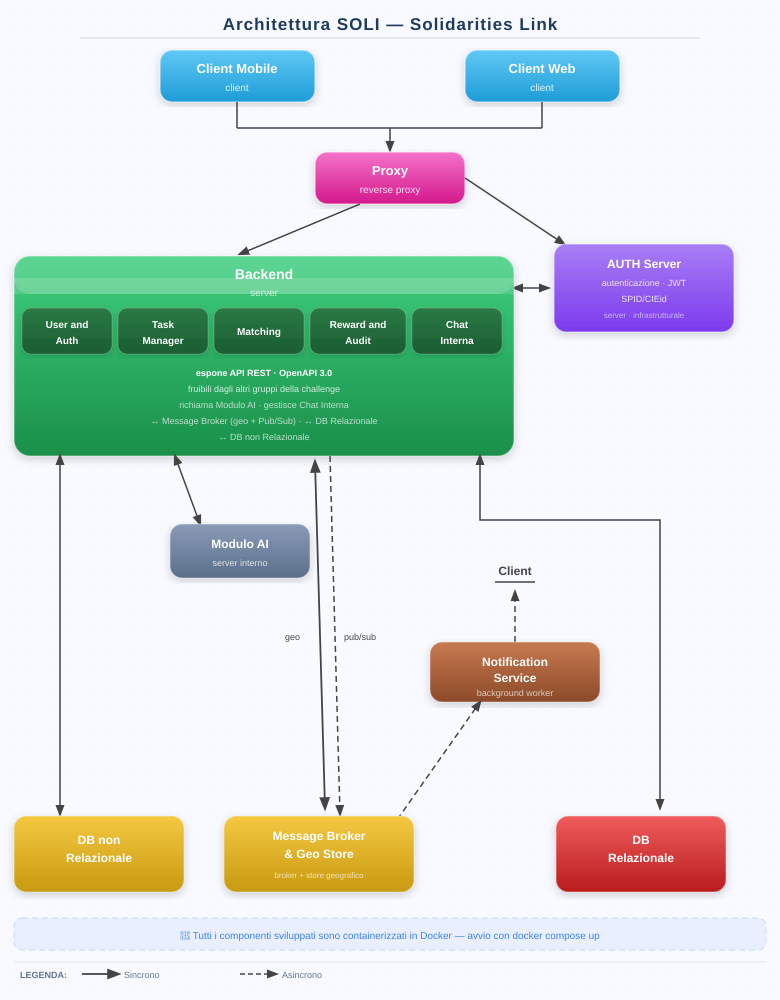

## Architecture Definition Document (ADD)

---

**Progetto:** Solidarities Link - SOLI

**Versione:** 0.1

**Data:** 17/02/2026

**Autori:** Piscitelli, Lombardi, Polperio, Victorino

---

## 1. Panoramica del Sistema (System Overview)

_Descrizione ad alto livello dello scopo dell'applicazione e del problema che risolve._

- **Obiettivo di Business:** [Descrivere brevemente l'obiettivo principale]
- **Utenti Target:** [Chi utilizzerà l'app Web e Mobile?]

---

## 2. Architettura di Alto Livello (High-Level Architecture)

_Schema concettuale di come i pezzi si incastrano._

- **Pattern Architetturale:** Microservizi containerizzati orchestrati con Docker Compose, comunicazione asincrona via Redis Pub/Sub
- **Diagramma di Contesto (C4 Level 1):**

---

## 3. Frontend Web

_Specifiche per l'applicazione browser-based._

### 3.1 Stack Tecnologico

| **Componente**         | **Scelta Tecnologica**              | **Motivazione** |
| ---------------------- | ----------------------------------- | --------------- |
| **Framework SPA**      | React 19                            | Standard de facto per interfacce complesse e reattive. Condivide componenti e logica con il mobile grazie all'ecosistema React. Open source, licenza MIT. |
| **Build Tool**         | Vite                                | Dev server con HMR istantaneo e build di produzione ottimizzate tramite Rollup. Open source, licenza MIT. |
| **Linguaggio**         | TypeScript                          | Tipizzazione statica per ridurre errori a runtime. |
| **UI Kit**             | MUI (Material UI)                   | Componenti Material Design 3, themizzabili. |
| **Routing**            | react-router-dom                    | Routing SPA client-side. |
| **Autenticazione**     | oidc-client-ts / react-oidc-context | Librerie OIDC per integrazione con Keycloak. |
| **Proxy (produzione)** | Nginx                               | Reverse proxy, routing, CORS e terminazione HTTPS. Battle-tested, leggerissimo in memoria. Open source, licenza BSD. |

### 3.2 Strategie Chiave

- **Rendering:** Client-side rendering (SPA)
- **Comunicazione API:** REST su `/api/` (proxy Vite in dev, Nginx in prod). WebSocket per la chat.
- **Autenticazione:** Authorization Code + PKCE tramite Keycloak (client `soli-frontend`, public)

---

## 4. Applicazione Mobile

_Specifiche per l'app nativa o cross-platform._

### 4.1 Stack Tecnologico

| **Componente**      | **Scelta Tecnologica** | **Motivazione** |
| ------------------- | ---------------------- | --------------- |
| **Approccio**       | Cross-platform         | Codebase unica per iOS e Android. |
| **Framework**       | React Native CLI       | Pieno controllo nativo, necessario per SPID/CIEid, notifiche push enterprise e ottimizzazioni di performance. Usato in produzione da Facebook, Microsoft, Shopify. Open source, licenza MIT. |
| **Linguaggio**      | TypeScript             | Tipizzazione statica. |
| **Routing**         | expo-router            | Routing file-based simile a Next.js. |
| **Auth**            | expo-auth-session      | OAuth2/OIDC con browser di sistema. |
| **Storage Sicuro**  | expo-secure-store      | Keychain (iOS) / Keystore (Android) per i token. |
| **Gradienti**       | expo-linear-gradient   | Equivalente CSS linear-gradient. |

### 4.2 Strategie Chiave

- **Supporto OS:** iOS e Android (versioni da definire)
- **Push Notifications:** FCM (Android) e APNS (iOS) tramite Notification Service Python
- **Autenticazione:** PKCE via `expo-auth-session`, token salvati in `expo-secure-store`
- **Deployment Stores:** Apple App Store e Google Play Store

---

## 5. Backend & API Layer

_Il cuore logico del sistema._

### 5.1 Stack Tecnologico

| **Componente**           | **Scelta Tecnologica**    | **Motivazione** |
| ------------------------ | ------------------------- | --------------- |
| **Linguaggio/Runtime**   | Java 21 (LTS)             | Virtual thread per gestire migliaia di connessioni simultanee senza la complessità del codice reattivo. |
| **Framework Backend**    | Quarkus                   | Ottimizzato per container: avvio in millisecondi, footprint ridotto. Genera automaticamente OpenAPI 3.0 dalle annotazioni. Open source, licenza Apache 2.0. |
| **API Style**            | REST (JSON)               | Base path `/api/`, autenticazione Bearer JWT da Keycloak. |
| **ORM**                  | Hibernate ORM Panache     | Active record pattern. |
| **Chat Service**         | Node.js + WebSocket       | Modello event-driven non bloccante: gestisce migliaia di WebSocket simultanei. Separato da Quarkus per non saturarne i thread. Open source, licenza MIT. |
| **Notification Service** | Python + Redis Pub/Sub    | Worker asincrono leggero per FCM/APNS. Scalabile indipendentemente dal backend. Open source, licenza PSF. |
| **Modulo AI/LLM**        | Python + Ollama (Llama 3) | LLM open-weight interamente in locale (Docker). Nessuna dipendenza da API cloud, costi variabili eliminati, dati nell'infrastruttura propria. Ollama: MIT. Llama: Meta Llama Community License. |
| **Documentazione API**   | OpenAPI 3.0 + Swagger UI  | Generata automaticamente da Quarkus dalle annotazioni del codice. UI interattiva su `/q/swagger-ui`. Open source, licenza Apache 2.0. |

### 5.2 Sicurezza & Auth

- **Authentication:** OAuth2 + OpenID Connect, Authorization Code + PKCE
- **Identity Provider:** Keycloak 26.x (realm `soli`, mantenuto da Red Hat). Evita di sviluppare da zero una componente critica per la sicurezza e permette l'integrazione con SPID/CIEid. Open source, licenza Apache 2.0.
- **Token:** JWT (Bearer), gestione refresh automatica
- **Authorization:** RBAC via ruoli Keycloak (`admin`, utente standard)
- **Endpoint protetti:** `/api/*` — richiedono token valido. Pubblici: `/api/health`, `/q/*`

### 5.3 Integrazioni Esterne (3rd Party)

- **SPID/CIEid** — Autenticazione nazionale tramite Keycloak (identity brokering)
- **FCM** (Firebase Cloud Messaging) — Notifiche push Android
- **APNS** (Apple Push Notification Service) — Notifiche push iOS

---

## 6. Data Layer (Persistenza)

_Dove e come vengono salvati i dati._

### 6.1 Database Principale — PostgreSQL

- **Tipologia:** Relazionale
- **Tecnologia:** PostgreSQL 16
- **Ruolo:** Dati strutturati e transazionali — utenti, task, Crediti SOLI, audit log. ACID compliance garantisce l'integrità delle transazioni. La geolocalizzazione è delegata a Redis, lasciando PostgreSQL focalizzato sui dati per cui è ottimizzato.
- **Strategia di Backup:** [Da definire — frequenza e retention]

Licenza: PostgreSQL (simile a MIT).

### 6.2 Cache, Geolocalizzazione e Message Broker — Redis

- **Tecnologia:** Redis
- **Ruolo geolocalizzazione:** Redis GeoSearch mantiene le posizioni dei volontari interamente in memoria. Query "trova tutti i volontari entro 2km" → singolo millisecondo su migliaia di record. Prestazioni impossibili da replicare con PostgreSQL anche con indici spaziali. Aggiornamento posizione = operazione atomica in memoria, zero impatto sul database principale.
- **Ruolo message broker:** Redis Pub/Sub disaccoppia Backend e Notification Service. La latenza dell'invio push non impatta i tempi di risposta delle API REST.

Licenza: BSD.

### 6.3 Database Documentale — MongoDB

- **Tipologia:** NoSQL documentale
- **Ruolo:** Messaggi della chat. TTL index nativo garantisce la cancellazione automatica dei messaggi al termine del task, senza processi schedulati. Modello documentale naturale per messaggi con metadati variabili.

Licenza: SSPL.

### 6.4 File Storage (Blob)

- **Storage Provider:** [Da definire]
- **Gestione Media:** [Da definire — compressione, ridimensionamento]

---

## 7. Infrastruttura & DevOps

_Come il sistema viene ospitato e rilasciato._

### 7.1 Hosting & Cloud

- **Cloud Provider:** [Da definire]
- **Risorse Compute:** [Da definire]

### 7.2 CI/CD (Continuous Integration/Deployment)

- **Pipeline Tool:** [Da definire — es. GitHub Actions]
- **Ambienti:**
   1. Development
   2. Staging
   3. Production

### 7.3 Containerizzazione — Docker + Docker Compose

- **Container Engine:** Docker. Ogni componente gira in un ambiente isolato e riproducibile indipendentemente dall'host. Open source, licenza Apache 2.0.
- **Orchestrazione (dev/staging):** Docker Compose. Intera infrastruttura descritta in un singolo file dichiarativo, avviabile con un unico comando. Ogni container è indipendente, aggiornabile e scalabile orizzontalmente.
- **Orchestrazione (produzione):** [Da definire — es. Kubernetes]

---

## 8. Monitoraggio & Observability

_Come sappiamo se il sistema è sano._

- **Logging Centralizzato:** [Da definire]
- **Error Tracking:** [Da definire]
- **Metrics & Dashboard:** [Da definire]
- **Health Check:** `/api/health` esposto dal backend Quarkus

---

## 9. Decisioni Architetturali (ADR)

_Registro delle decisioni importanti prese durante la definizione._

| **ID**  | **Titolo Decisione**                                         | **Status** | **Data** |
| ------- | ------------------------------------------------------------ | ---------- | -------- |
| ADR-001 | Redis per geolocalizzazione invece di PostGIS su PostgreSQL  | Accettato  | —        |
| ADR-002 | Chat Service separato (Node.js) dal backend Quarkus          | Accettato  | —        |
| ADR-003 | LLM in locale con Ollama invece di API cloud esterne         | Accettato  | —        |
| ADR-004 | Keycloak come Identity Provider con supporto SPID/CIEid      | Accettato  | —        |
| ADR-005 | MongoDB per messaggi di chat (TTL index nativo)              | Accettato  | —        |

---

## 10. Considerazioni Future & Debito Tecnico

- Orchestrazione Kubernetes per produzione ad alta disponibilità
- Definire strategia di backup PostgreSQL e MongoDB
- Implementazione SPID/CIEid via Keycloak identity brokering
- Scalabilità orizzontale del Chat Service e Notification Service
- Monitoraggio e alerting (Prometheus + Grafana)
- Definire versioni minime OS supportate per l'app mobile

---
